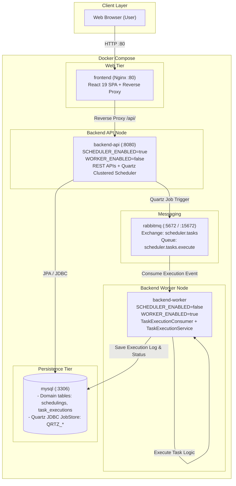

# Distributed Task Scheduling Platform

A scalable, distributed task scheduling platform built with **Spring Boot 4 (Java 25)**, **Quartz Scheduler**, **RabbitMQ**, **MySQL 8.4**, and **React 19 (TypeScript + Vite)**.

The platform provides a responsive administrative web UI to create, edit, pause, resume, and monitor scheduled jobs with dynamic parameter schemas and flexible timing options (One-Time, Interval, Weekly, and Cron expressions), coupled with an asynchronous, decoupled multi-node backend topology.

---

## 📑 Table of Contents
- [Architecture & Topology](#architecture--topology)
- [Core Capabilities](#core-capabilities)
  - [1. Flexible Scheduling Capabilities](#1-flexible-scheduling-capabilities)
  - [2. Predefined Read-Only Tasks](#2-predefined-read-only-tasks)
  - [3. Dynamic Parameter Schemas & Validation](#3-dynamic-parameter-schemas--validation)
  - [4. Schedulings Server-Side Pagination](#4-schedulings-server-side-pagination)
  - [5. Quartz Execution History & Live Log Stream](#5-quartz-execution-history--live-log-stream)
- [How to Run the System](#how-to-run-the-system)
  - [Prerequisites](#prerequisites)
  - [Option A: Running with Docker Compose (Recommended)](#option-a-running-with-docker-compose-recommended)
  - [Option B: Local Standalone Development](#option-b-local-standalone-development)
  - [Ports & Service Access URLs](#ports--service-access-urls)
- [Design Decisions](#design-decisions)
- [Assumptions Made](#assumptions-made)
- [Automated Testing & Quality Assurance](#automated-testing--quality-assurance)
  - [Running Backend Tests (37 Tests)](#running-backend-tests-37-tests)
  - [Running Frontend Tests (64 Tests)](#running-frontend-tests-64-tests)

---

## Architecture & Topology

The platform implements a **2-Node role-separated architecture** backed by clustered persistence and message queuing:



### Component Breakdown
1. **`frontend` (Port 80):** Multi-stage production build with Node 22 and Nginx Alpine. Serves the React SPA, provides execution log streams and scheduling modals, and proxies `/api/*` requests to `http://backend-api:8080/api/` to avoid CORS issues.
2. **`backend-api` (Port 8080):** Spring Boot service operating in **API / Scheduler mode** (`SCHEDULER_ENABLED=true`, `WORKER_ENABLED=false`). Exposes REST endpoints (`/api/schedulings`, `/api/tasks`, `/api/executions`), validates parameter schemas, and registers jobs with the clustered Quartz Scheduler. When a Quartz trigger fires, it dispatches an execution command to RabbitMQ.
3. **`backend-worker`:** Spring Boot service operating in **Worker mode** (`SCHEDULER_ENABLED=false`, `WORKER_ENABLED=true`). Listens to RabbitMQ, consumes execution tasks, executes task logic, records execution history into `task_executions`, and updates scheduling status/timestamps.
4. **`rabbitmq` (Ports 5672 & 15672):** Asynchronous message broker with a direct exchange (`scheduler.tasks`) and durable queue (`scheduler.tasks.execute`).
5. **`mysql` (Port 3306):** MySQL 8.4 storing the application domain tables (`schedulings`, `task_executions`) and the Quartz JDBC JobStore clustering tables (`QRTZ_*`).

---

## Core Capabilities

### 1. Flexible Scheduling Capabilities
Similar to standard enterprise scheduling and calendar systems, the platform supports 4 distinct timing modes:
* **One-Time (`ONE_TIME`):** Executes once at an ISO-8601 timestamp in the future, automatically transitioning the scheduling status to `COMPLETED` when done.
* **Recurring Interval (`INTERVAL`):** Executes every *X* seconds, minutes, or hours (e.g., every 30 seconds, every 5 minutes, every 2 hours), repeating indefinitely.
* **Weekly (`WEEKLY`):** Executes on specific selected days of the week (e.g., `MON, WED, FRI`) at a specified 24-hour time of day (e.g., `09:30`).
* **Cron Expression (`CRON`):** Advanced Quartz 6- or 7-field cron expressions (e.g., `0 */5 * ? * *` for every 5 minutes, `0 0 9 ? * MON-FRI` for weekday mornings). Includes preset shortcuts in the UI.

### 2. Predefined Read-Only Tasks
In accordance with system specifications, task types are **predefined and read-only** (immutable constants declared in Java that cannot be added, edited, or deleted through the API or UI):
* **`LOG_TASK` ("Log Execution Task"):** Writes formatted diagnostic output to application logs. Accepts a required `message` parameter.
* **`EMAIL_TASK` ("Email Dispatch Task"):** Simulates email delivery. Accepts `to` (recipient email, required), `subject` (required), and `body` (optional).
* **`DB_QUERY_TASK` ("Database Query Task"):** Simulates a database health query. Accepts `query` (SQL string, required) and `timeoutSeconds` (numeric, optional, defaults to 30s).

### 3. Dynamic Parameter Schemas & Validation
* **Schema Metadata:** Exposed via `GET /api/tasks`, providing parameter names, types (`STRING`, `NUMBER`), formats (`email`), required flags, defaults, and min/max constraints.
* **Dynamic UI Form:** The React UI dynamically generates form fields according to the selected task schema, rendering input types, email validation, and required asterisks (`*`).
* **Backend Validation:** Both the UI and backend validator (`TaskParameterValidator`) enforce parameter presence and types, rejecting invalid payloads with standardized RFC 9457 error details (`400 Bad Request`).

### 4. Schedulings Server-Side Pagination
* **Optimized Data Retrieval:** `GET /api/schedulings?page=0&size=10&sort=createdAt,desc` delivers paginated payloads wrapped in `PageResponse<SchedulingResponse>`, eliminating unbounded array payloads.
* **Interactive Navigation:** The dashboard features page size selection (5, 10, 25, 50), page navigation controls, item range indicators, and total element counts.

### 5. Quartz Execution History & Live Log Stream
* **Persistent Execution Logging:** Every trigger fired by Quartz and executed by background workers is persisted in the `task_executions` database table, capturing task name, type, execution duration (ms), trigger fire time, completion status (`SUCCESS` or `FAILED`), and human-readable execution output/logs.
* **Slide-Out Executions Drawer:**
  * **Live Auto-Refresh:** Supports real-time polling (3-second interval) with a pulsing visual indicator (`Live` / `Paused`) and manual refresh capability.
  * **Contextual Views:** Inspect recent triggers across all jobs via the global **"Live Stream →"** / **"Executions"** actions, or inspect executions for a specific schedule via the **"View executions"** row action button.
  * **Console-Style Output:** Displays execution log streams in formatted monospace code blocks with timestamps, duration, and status badges.

---

## How to Run the System

### Prerequisites
* **Docker & Docker Compose:** Docker Engine 24+ and Docker Compose v2+ installed.
* *(Optional for local development without Docker)*:
  * Java Development Kit (JDK) 25.
  * Node.js 22+ and npm.
  * Local MySQL 8.4 and RabbitMQ 4.x instances.

---

### Option A: Running with Docker Compose (Recommended)

1. **Clone the repository:**
   ```bash
   git clone <repo-url>
   cd memcyco
   ```

2. **Build and start the entire stack:**
   ```bash
   docker compose up --build -d
   ```

3. **Verify running containers:**
   ```bash
   docker compose ps
   ```
   All 5 containers (`scheduler-mysql`, `scheduler-rabbitmq`, `scheduler-backend-api`, `scheduler-backend-worker`, `scheduler-frontend`) should display `Up` or `healthy`.

4. **Access the application:**
   * **Web UI Dashboard:** Open [http://localhost](http://localhost) in your browser.
   * **Backend REST API:** [http://localhost:8080/api/schedulings](http://localhost:8080/api/schedulings)
   * **RabbitMQ Management Dashboard:** [http://localhost:15672](http://localhost:15672) (User: `guest`, Password: `guest`).

5. **Stop and clean up containers:**
   ```bash
   docker compose down -v
   ```

---

### Option B: Local Standalone Development

#### 1. Start Infrastructure (MySQL & RabbitMQ)
You can start only the databases using Docker:
```bash
docker compose up mysql rabbitmq -d
```

#### 2. Run Backend API & Worker
Ensure `JAVA_HOME` points to JDK 25:
```bash
cd backend
# Set JAVA_HOME if not already pointing to JDK 25:
# $env:JAVA_HOME="C:\Program Files\Java\jdk-25" (Windows PowerShell)
# export JAVA_HOME=/path/to/jdk-25 (macOS/Linux)

./mvnw spring-boot:run
```
*(By default, running locally with `application.yaml` enables both scheduler and worker roles).*

#### 3. Run Frontend
In a new terminal window:
```bash
cd frontend
npm install
npm run dev
```
The frontend dev server runs at `http://localhost:3000` and automatically proxies `/api` calls to `http://localhost:8080`.

---

### Ports & Service Access URLs

| Service | Port | Endpoint URL | Description | Default Credentials |
| :--- | :--- | :--- | :--- | :--- |
| **Frontend UI** | `80` (or `3000` dev) | `http://localhost` | React Dashboard & Nginx reverse proxy | None |
| **Backend API** | `8080` | `http://localhost:8080/api` | Spring Boot REST API (`/api/schedulings`, `/api/tasks`, `/api/executions`) | None |
| **RabbitMQ Web** | `15672` | `http://localhost:15672` | RabbitMQ Management Console | `guest` / `guest` |
| **RabbitMQ AMQP** | `5672` | `amqp://localhost:5672` | AMQP Protocol Broker | `guest` / `guest` |
| **MySQL Database**| `3306` | `jdbc:mysql://localhost:3306/scheduler_db` | Relational store (`schedulings`, `task_executions`) & Quartz JobStore | `appuser` / `appsecret` |

---

## Design Decisions

1. **Clustered Quartz with JDBC JobStore (`org.quartz.impl.jdbcjobstore.StdJDBCDelegate`):**
   * *Rationale:* In-memory schedulers lose all triggers when restarted and cannot scale across multiple nodes. By persisting triggers and job state into MySQL `QRTZ_*` tables with `isClustered=true`, Quartz coordinates distributed locking and ensures that scheduled triggers survive restarts and failover gracefully without duplicate firing.
2. **Two-Node Topology & Role Separation (`SCHEDULER_ENABLED` vs `WORKER_ENABLED`):**
   * *Rationale:* In high-throughput scheduling platforms, executing heavy job workloads on the same JVM that manages Quartz triggers risks thread starvation, leading to misfired triggers. Decoupling the system into `backend-api` (API + scheduling) and `backend-worker` (task execution) via feature toggles enables independent horizontal scaling of workers without complicating the API layer.
3. **RabbitMQ Task Queue Dispatch:**
   * *Rationale:* RabbitMQ provides message persistence, buffering, and acknowledgment guarantees. When a Quartz trigger fires, `TaskExecutionJob` publishes a `TaskExecutionMessage` to `scheduler.tasks` exchange and returns immediately. Workers consume messages from `scheduler.tasks.execute` with automatic retries and dead-letter safety.
4. **Dynamic Schema-Driven Form Generation:**
   * *Rationale:* Hardcoding form fields in the React UI creates tight coupling whenever tasks are modified or added. Instead, the backend defines `ParameterDefinition` objects (type, default, required, min, max, format). The frontend consumes `GET /api/tasks` and dynamically renders the appropriate UI controls, ensuring client-side validation matches server-side rules.
5. **Nginx Reverse Proxy in Frontend Container:**
   * *Rationale:* The frontend production Docker container bundles an Nginx reverse proxy configured to route `/api/*` to `backend-api:8080`. This eliminates browser Cross-Origin Resource Sharing (CORS) complications, prevents leaking backend ports, and provides seamless Single Page Application (SPA) fallback routing (`try_files $uri /index.html`).
6. **Spec-Driven Development (SDD) Protocol:**
   * *Rationale:* All architectural choices, schemas, and features are formalized in `docs/adr/` and `docs/specs/` prior to implementation, ensuring architectural traceability and preventing specification drift.

---

## Assumptions Made

1. **Immutable Task Catalog:** Tasks are treated as predefined application capabilities (blueprints), not dynamic user-defined scripts. Users create *schedulings* that configure when and with what parameters a predefined task runs.
2. **Timezone Storage:** All schedule timestamps (`nextRunAt`, `createdAt`, `updatedAt`, `startAt`) are stored internally in **UTC** (`Instant`). The frontend converts UTC timestamps to the operator's local browser timezone for display.
3. **Initial State (Clean Database):** Upon initial deployment with an empty MySQL volume, there are zero active schedules. Operators create schedules through the UI or REST API.
4. **Quartz Schema Initialization:** `spring.quartz.jdbc.initialize-schema=always` is configured in `application.yaml`, allowing Spring Boot to automatically initialize Quartz tables (`QRTZ_*`) on fresh installations.
5. **Weekly Schedule Cron Mapping:** Weekly schedules selected via the UI (e.g. MON, FRI at 09:00) are converted into standard Quartz cron expressions (`0 0 9 ? * MON,FRI`) by `QuartzTriggerBuilder`.

---

## Automated Testing & Quality Assurance

The codebase includes comprehensive automated test suites spanning both the backend and frontend.

### Running Backend Tests (37 Tests)
The backend test suite covers parameter validation, Quartz trigger construction, Spring Data JPA persistence, MVC slice tests, role activation toggles, message dispatch, and task execution tracking:
* **Unit Tests:** `QuartzTriggerBuilderTest`, `TaskParameterValidatorTest`, `TaskExecutionServiceTest`
* **Slice Tests:** `SchedulingControllerTest`, `TaskControllerTest`, `ExecutionControllerTest`, `SchedulingRepositoryTest`, `TaskExecutionRepositoryTest`
* **Integration Tests:** `RoleActivationIntegrationTest`, `TaskDispatchAndExecutionTest`

To run backend tests locally (requires JDK 25):
```bash
cd backend
./mvnw clean test
```

### Running Frontend Tests (64 Tests)
The frontend test suite is powered by **Vitest** and **React Testing Library**, covering API error extraction, pagination, badge styling, table interactions (delete confirmation dialogs, status toggles, execution drawer open), live execution stream auto-polling, dynamic schema form rendering, timing selectors, and scheduling modals:
* **Unit & Hook Tests:** `client.test.ts`, `schedulingsApi.test.ts`, `useTasks.test.ts`, `useSchedulings.test.ts`
* **Component Tests:** `Badge.test.tsx`, `Pagination.test.tsx`, `SchedulingsTable.test.tsx`, `ExecutionsDrawer.test.tsx`, `DynamicParameterForm.test.tsx`, `ScheduleTimingSelector.test.tsx`, `SchedulingModal.test.tsx`

To run frontend tests:
```bash
cd frontend
npm test
```

To run the production bundle check:
```bash
cd frontend
npm run build
```
