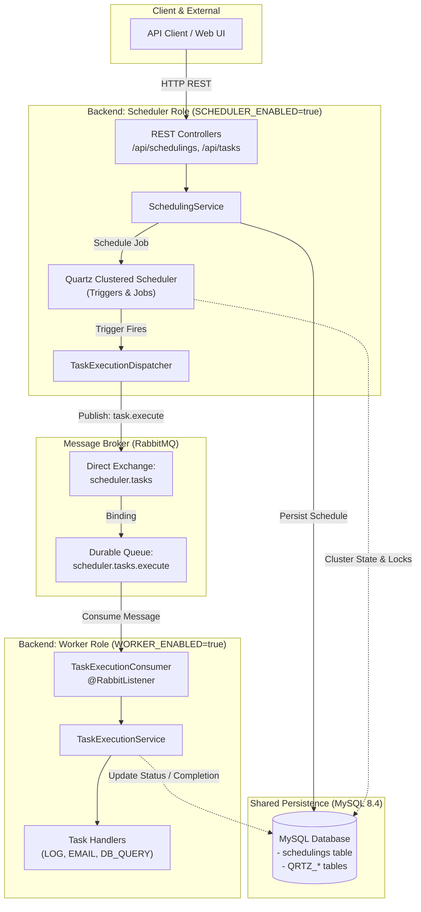
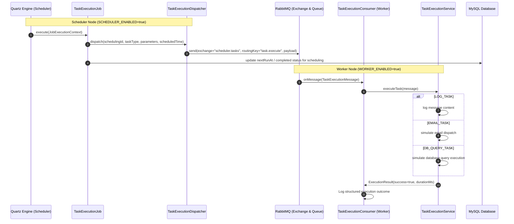

# Specification 002: Asynchronous Execution Topology & Role Separation via RabbitMQ

- **ID:** `002`
- **Title:** Asynchronous Execution Topology & Role Separation via RabbitMQ
- **Status:** `Implemented`
- **Date:** 2026-11-17
- **Author:** AI Agent
- **Dependencies:** `docs/specs/000-system-architecture.md`, `docs/specs/001-backend-core-scheduling.md`
- **Feature Registry Link:** [FEATURE_REGISTRY.md](FEATURE_REGISTRY.md)

---

## 1. Scope & Objectives

### 1.1 Overview
This specification details the architectural evolution of the Spring Boot 4.1.2 (Java 25) scheduling backend from a single-node direct execution model into an asynchronous, distributed execution topology split into two independent node roles:
1. **Scheduler Node (`SCHEDULER_ENABLED=true`)**: Exposes REST APIs, manages schedule definitions in MySQL, triggers Quartz jobs, and dispatches execution payloads to RabbitMQ.
2. **Worker Node (`WORKER_ENABLED=true`)**: Consumes task execution messages from RabbitMQ, executes simulated task business logic (`LOG_TASK`, `EMAIL_TASK`, `DB_QUERY_TASK`), and records execution completion.

In addition, a production-ready multi-stage `Dockerfile` and `.dockerignore` will be introduced to package the backend application with optimal container JVM tuning and security boundaries.

### 1.2 In Scope
1. **RabbitMQ Messaging Infrastructure:**
   - Spring AMQP starter integration (`spring-boot-starter-amqp`).
   - Durable direct exchange: `scheduler.tasks`.
   - Durable execution queue: `scheduler.tasks.execute`.
   - Queue-to-exchange binding using routing key: `task.execute`.
   - Jackson 2 JSON message converter (`Jackson2JsonMessageConverter`) for clean JSON payload serialization without exposing JPA entities.
2. **Role Separation via Configuration:**
   - Environment and property toggles: `SCHEDULER_ENABLED` and `WORKER_ENABLED` (both defaulting to `true` when omitted to preserve backward-compatible single-instance development).
   - Conditioning REST controllers (`SchedulingController`, `TaskController`), schedule lifecycle services, and task dispatching on `SCHEDULER_ENABLED=true`.
   - Conditioning RabbitMQ message listeners, task consumers, and execution handlers on `WORKER_ENABLED=true`.
3. **Outbox & Task Dispatch Pipeline:**
   - Quartz job execution on the scheduler node dispatches a strongly-typed `TaskExecutionMessage` to RabbitMQ rather than executing task logic directly.
   - Worker consumes `TaskExecutionMessage`, delegates to task handlers, and logs structured execution outcomes.
4. **Containerization:**
   - Multi-stage `Dockerfile` in `backend/`:
     - Stage 1 (Builder): `eclipse-temurin:25-jdk-alpine` compiling and packaging the executable JAR.
     - Stage 2 (Runtime): `eclipse-temurin:25-jre-alpine` running as a non-root user (`appuser:appgroup`), configured with container JVM flags (`-XX:+UseContainerSupport -XX:MaxRAMPercentage=75.0`).
   - `.dockerignore` excluding build artifacts, local caches (`target/`, `build/`, `.gradle/`), and IDE configurations.
5. **Automated Testing Suite:**
   - Integration tests verifying role-based bean conditional loading.
   - RabbitMQ dispatch and message processing integration tests using Spring AMQP testing utilities or mock broker.

### 1.3 Out of Scope
- Frontend dashboard integration (covered in Stage 3).
- Docker Compose multi-service orchestration (covered in Stage 4).
- Dynamic worker autoscaling policies.

---

## 2. Architecture & Design

### 2.1 Topology & Role Split



### 2.2 Event Contract: TaskExecutionMessage

In accordance with event-driven messaging guidelines, messages are immutable Java records representing versioned contracts:

```java
package com.shanin.scheduler.messaging;

import com.shanin.scheduler.model.TaskType;
import java.time.Instant;
import java.util.Map;
import java.util.UUID;

public record TaskExecutionMessage(
    UUID executionId,
    UUID schedulingId,
    String taskName,
    TaskType taskType,
    Map<String, Object> taskParameters,
    Instant scheduledFireTime,
    Instant dispatchedAt
) {
    public static TaskExecutionMessage create(
        UUID schedulingId,
        String taskName,
        TaskType taskType,
        Map<String, Object> taskParameters,
        Instant scheduledFireTime
    ) {
        return new TaskExecutionMessage(
            UUID.randomUUID(),
            schedulingId,
            taskName,
            taskType,
            taskParameters != null ? taskParameters : Map.of(),
            scheduledFireTime,
            Instant.now()
        );
    }
}
```

### 2.3 RabbitMQ Topology Configuration

- **Exchange:** `scheduler.tasks` (`DirectExchange`, durable = true, autoDelete = false)
- **Queue:** `scheduler.tasks.execute` (`QueueBuilder.durable("scheduler.tasks.execute").build()`)
- **Routing Key:** `task.execute`
- **Converter:** `Jackson2JsonMessageConverter` registered as default `MessageConverter` bean.

```java
@Configuration
public class RabbitMqConfig {
    public static final String EXCHANGE_TASKS = "scheduler.tasks";
    public static final String QUEUE_TASK_EXECUTE = "scheduler.tasks.execute";
    public static final String ROUTING_KEY_TASK_EXECUTE = "task.execute";

    @Bean
    public DirectExchange tasksExchange() {
        return new DirectExchange(EXCHANGE_TASKS, true, false);
    }

    @Bean
    public Queue taskExecuteQueue() {
        return QueueBuilder.durable(QUEUE_TASK_EXECUTE).build();
    }

    @Bean
    public Binding taskExecuteBinding(Queue taskExecuteQueue, DirectExchange tasksExchange) {
        return BindingBuilder.bind(taskExecuteQueue).to(tasksExchange).with(ROUTING_KEY_TASK_EXECUTE);
    }

    @Bean
    public MessageConverter jsonMessageConverter(ObjectMapper objectMapper) {
        return new Jackson2JsonMessageConverter(objectMapper);
    }
}
```

### 2.4 Role Separation & Feature Toggles

Configuration in `application.yaml`:
```yaml
SCHEDULER_ENABLED: ${SCHEDULER_ENABLED:true}
WORKER_ENABLED: ${WORKER_ENABLED:true}

spring:
  rabbitmq:
    host: ${RABBITMQ_HOST:localhost}
    port: ${RABBITMQ_PORT:5672}
    username: ${RABBITMQ_USERNAME:guest}
    password: ${RABBITMQ_PASSWORD:guest}
```

Bean Activation Matrix:

| Bean / Component | `SCHEDULER_ENABLED=true` | `WORKER_ENABLED=true` | Condition Annotation |
|:---|:---:|:---:|:---|
| `SchedulingController` | Active | Inactive | `@ConditionalOnProperty(name = "SCHEDULER_ENABLED", havingValue = "true", matchIfMissing = true)` |
| `TaskController` | Active | Inactive | `@ConditionalOnProperty(name = "SCHEDULER_ENABLED", havingValue = "true", matchIfMissing = true)` |
| `SchedulingService` | Active | Inactive | `@ConditionalOnProperty(name = "SCHEDULER_ENABLED", havingValue = "true", matchIfMissing = true)` |
| `QuartzSchedulerService` | Active | Inactive | `@ConditionalOnProperty(name = "SCHEDULER_ENABLED", havingValue = "true", matchIfMissing = true)` |
| `TaskExecutionDispatcher` | Active | Inactive | `@ConditionalOnProperty(name = "SCHEDULER_ENABLED", havingValue = "true", matchIfMissing = true)` |
| `TaskExecutionConsumer` | Inactive | Active | `@ConditionalOnProperty(name = "WORKER_ENABLED", havingValue = "true", matchIfMissing = true)` |
| `TaskExecutionService` | Inactive | Active | `@ConditionalOnProperty(name = "WORKER_ENABLED", havingValue = "true", matchIfMissing = true)` |

*Note: In the default local setup (`SCHEDULER_ENABLED=true, WORKER_ENABLED=true`), both roles co-exist in a single unified instance without conflict.*

### 2.5 Dispatch & Execution Sequence



---

## 3. Containerization Design (Dockerfile)

### 3.1 Multi-Stage Dockerfile (`backend/Dockerfile`)
1. **Stage 1: Builder (`eclipse-temurin:25-jdk-alpine`)**
   - Installs Maven / uses wrapper build tools.
   - Copies `pom.xml`, downloads dependencies in cacheable layer.
   - Copies source code (`src/`), compiles, runs tests / packages application JAR into `target/scheduler-0.0.1-SNAPSHOT.jar`.
2. **Stage 2: Runtime (`eclipse-temurin:25-jre-alpine`)**
   - Creates a dedicated non-root user and group (`appuser:appgroup`, UID/GID 10001).
   - Configures container-aware JVM flags:
     `-XX:+UseContainerSupport -XX:MaxRAMPercentage=75.0`
   - Copies only the executable `.jar` from the builder stage.
   - Exposes application port `8080`.
   - Defines `ENTRYPOINT ["java", "-XX:+UseContainerSupport", "-XX:MaxRAMPercentage=75.0", "-jar", "/app/app.jar"]`.

### 3.2 Docker Ignore (`backend/.dockerignore`)
Excludes:
- `target/`, `build/`
- `.gradle/`, `gradle/`
- `.idea/`, `*.iml`, `.vscode/`, `.settings/`, `.classpath`, `.project`
- `*.log`
- `.git/`, `.gitignore`

---

## 4. Acceptance Criteria

### Scenario 1: RabbitMQ Topology Initialization
- **Given** the backend application starts with RabbitMQ auto-configuration enabled,
- **When** the Spring application context initializes,
- **Then** direct exchange `scheduler.tasks`, queue `scheduler.tasks.execute`, and binding `task.execute` are registered.
- **And** `Jackson2JsonMessageConverter` is wired for message serialization.

### Scenario 2: Scheduler Node Role Isolation
- **Given** `SCHEDULER_ENABLED=true` and `WORKER_ENABLED=false`,
- **When** the application starts,
- **Then** REST endpoints `/api/schedulings` and `/api/tasks` are active.
- **And** Quartz trigger scheduler and `TaskExecutionDispatcher` beans are present in the context.
- **And** `TaskExecutionConsumer` bean is NOT loaded in the context.

### Scenario 3: Worker Node Role Isolation
- **Given** `SCHEDULER_ENABLED=false` and `WORKER_ENABLED=true`,
- **When** the application starts,
- **Then** REST endpoints `/api/schedulings` and `/api/tasks` are NOT registered (HTTP 404).
- **And** `TaskExecutionConsumer` and `TaskExecutionService` beans are active and listening to `scheduler.tasks.execute`.
- **And** `SchedulingService` and `TaskExecutionDispatcher` are NOT loaded in the context.

### Scenario 4: Asynchronous Dispatch & Execution Flow
- **Given** a scheduling trigger fires in Quartz,
- **When** `TaskExecutionJob` executes,
- **Then** it produces a JSON payload to RabbitMQ direct exchange `scheduler.tasks` with routing key `task.execute`.
- **And** the worker's `TaskExecutionConsumer` receives the payload, executes the respective task logic (`LOG_TASK`, `EMAIL_TASK`, or `DB_QUERY_TASK`), and logs the execution result.

### Scenario 5: Container Build & Non-Root Execution
- **Given** the multi-stage `backend/Dockerfile`,
- **When** the Docker image is built,
- **Then** it compiles the application in an Alpine JDK 25 stage and packages the runtime in an Alpine JRE 25 stage.
- **And** the runtime container executes under an unprivileged user with `-XX:+UseContainerSupport -XX:MaxRAMPercentage=75.0`.
